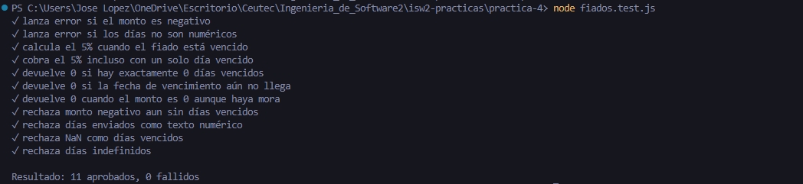

PS C:\Users\Jose Lopez\OneDrive\Escritorio\Ceutec\Ingenieria_de_Software2\isw2-practicas\practica-4> node fiados.test.js
✓ lanza error si el monto es negativo
✓ lanza error si los días no son numéricos
✓ calcula el 5% cuando el fiado está vencido
✓ cobra el 5% incluso con un solo día vencido
✓ devuelve 0 si hay exactamente 0 días vencidos
✓ devuelve 0 si la fecha de vencimiento aún no llega
✓ devuelve 0 cuando el monto es 0 aunque haya mora
✓ rechaza monto negativo aun sin días vencidos
✓ rechaza días enviados como texto numérico
✓ rechaza NaN como días vencidos
✓ rechaza días indefinidos

Resultado: 11 aprobados, 0 fallidos

