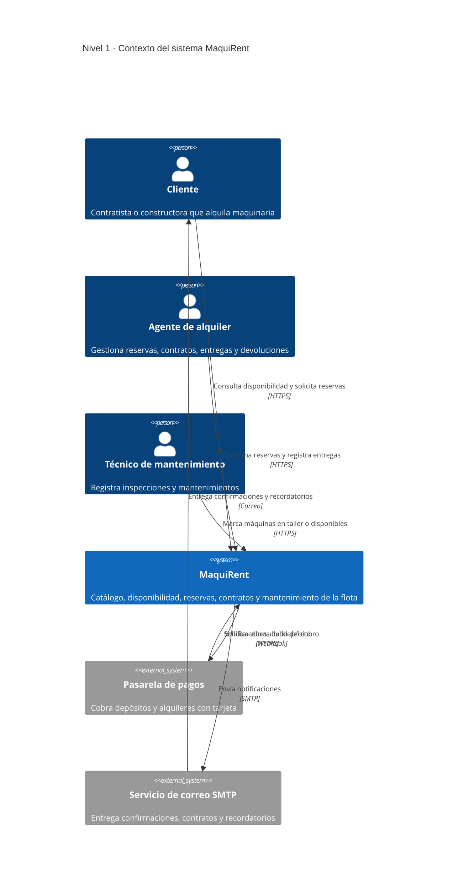
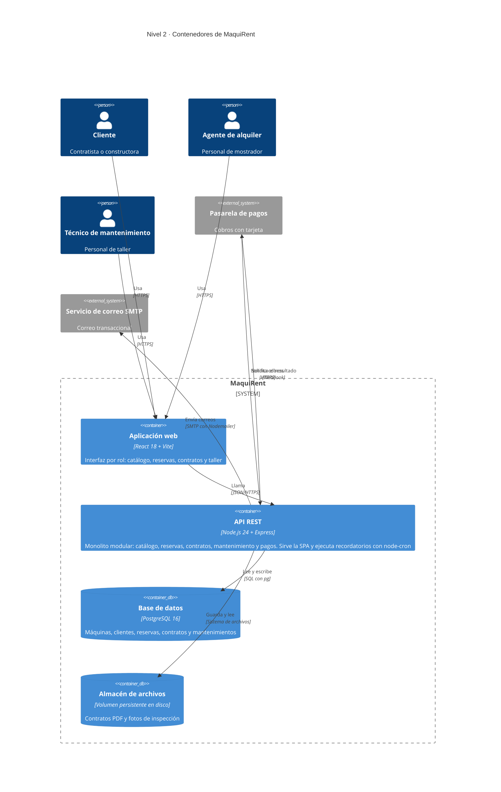

# Práctica 6: arquitectura C4 del sistema de alquiler de maquinaria pesada

**MaquiRent** es un sistema web para una empresa que alquila maquinaria pesada (excavadoras, retroexcavadoras, montacargas, rodillos). Permite consultar disponibilidad, reservar equipos, generar contratos, registrar entregas y devoluciones, y programar mantenimientos. Una máquina en taller no puede reservarse.

Los diagramas usan el modelo [C4](https://c4model.com/) en Mermaid. GitHub los dibuja directamente en la vista del archivo. Así, la documentación se actualiza en el mismo PR que el código.

## Nivel 1: contexto

**Decisiones y atributos de calidad**

- **D1. Elegí delegar los cobros en una pasarela externa.** Priorizo la **seguridad** sobre el **control** y el **costo** de las comisiones.
- MaquiRent no recibe ni almacena números de tarjeta, solo el identificador y el estado del cobro. Así queda fuera de la parte más exigente de PCI DSS.
- **D2. Elegí un único sistema con roles para los tres actores, en vez de una aplicación por actor.** Priorizo la **mantenibilidad** y la **consistencia** sobre una experiencia especializada.
- Reservas, entregas y mantenimiento modifican el mismo dato: la disponibilidad de cada máquina.
- Si ese dato estuviera repartido entre sistemas, habría que sincronizarlos para que una máquina en taller no aparezca como reservable.

## Nivel 2: contenedores

**Decisiones y atributos de calidad**

- **D3. Elegí un monolito modular en Express en vez de microservicios.** Priorizo la **mantenibilidad** y la **simplicidad de despliegue** sobre la **escalabilidad** independiente.
- La carga prevista son decenas de reservas al día, y el equipo tiene una o dos personas. Con microservicios habría que operar varios procesos, un broker y la comunicación de red entre ellos.
- Separar los módulos dentro del código mantiene la posibilidad de extraer un servicio si alguno llega a necesitarlo.
- **D4. Elegí PostgreSQL con una restricción de exclusión sobre el rango de fechas de cada máquina.** Priorizo la **integridad** de los datos sobre el **rendimiento** de escritura.
- Reservar dos veces la misma excavadora es un error caro. Con esa restricción, la base de datos rechaza la segunda reserva aunque dos agentes confirmen al mismo tiempo.

## Borrador con IA y correcciones

Generé un borrador de ambos niveles con IA a partir de esta instrucción: *«Generá el C4 nivel 1 y 2 en Mermaid de un sistema de alquiler de maquinaria pesada»*. Después lo comparé con el alcance real del sistema. Corregí lo siguiente:

| # | Qué inventó la IA | Por qué es una alucinación o un exceso | Corrección |
| --- | --- | --- | --- |
| 1 | Microservicios de inventario, reservas, pagos y notificaciones, escritos en **NestJS, Go y Python** | Para este equipo y esta carga, sumaba cuatro despliegues y tres lenguajes. Además, separaba la regla de disponibilidad entre servicios | Un monolito modular: **Node.js + Express** (D3) |
| 2 | **Apache Kafka**, como broker de eventos | No hay un volumen de eventos ni varios consumidores que lo justifiquen | Llamadas internas entre módulos; recordatorios con **node-cron** |
| 3 | **API Gateway Kong + GraphQL** | Solo hay un cliente, la SPA. Un gateway agregaba un salto de red y otra pieza que configurar | Una **API REST** en Express |
| 4 | **Redis**, como caché | No había ningún problema de rendimiento que resolver. Un catálogo de decenas de máquinas responde bien desde PostgreSQL | Eliminado |
| 5 | **MongoDB** para el catálogo y PostgreSQL para las reservas | Con dos bases de datos se pierde la transacción entre la máquina y su reserva | Solo **PostgreSQL** (D4) |
| 6 | **Elasticsearch** para búsquedas | Filtrar por tipo, capacidad y fechas se resuelve con SQL e índices | Eliminado |
| 7 | **App móvil en React Native** para técnicos y operadores | No existe ese desarrollo. Los técnicos usan la misma web desde la tablet del taller | Solo la **aplicación web** |
| 8 | **Kubernetes (EKS)** y **Amazon S3** | Es infraestructura que el proyecto no usa ni tiene presupuestada | Un servidor y un **volumen persistente** para los archivos |
| 9 | **Stripe** como pasarela | Stripe no ofrece cuentas de comercio en Honduras | Una **pasarela de pagos** genérica, que se definirá con el banco adquirente |
| 10 | **Twilio**, para SMS y WhatsApp | El alcance solo incluye notificaciones por correo | **Servicio SMTP** |
| 11 | **Plataforma IoT/GPS de telemetría**, **Google Maps** y **ERP SAP** | Ninguna de esas integraciones está en el alcance | Eliminados del contexto |
| 12 | Actores **Administrador** y **Operador de máquina** | El operador no usa el sistema. La administración es un permiso del agente, no un actor distinto | Tres actores: **cliente, agente y técnico** |

Criterio aplicado: cada contenedor o sistema externo debe corresponder a una tecnología que se usa o a una necesidad del alcance. Si la única razón para incluirlo era que «suele aparecer en arquitecturas modernas», se eliminó.
